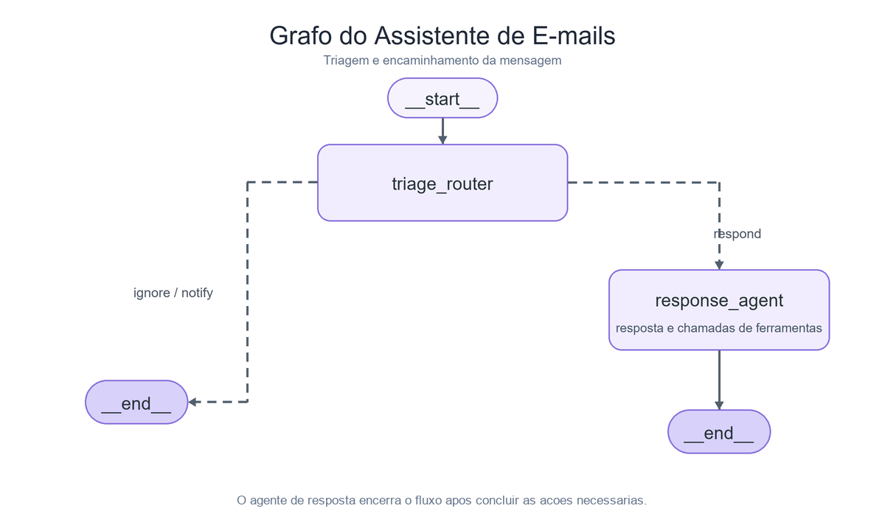

# Assistente de e-mails

Assistente em Python que classifica e-mails como `ignore`, `notify` ou `respond`.
Quando precisa responder, usa um agente LangChain com ferramentas de e-mail,
agenda e memória. As integrações de e-mail e agenda deste projeto são exemplos
locais: elas retornam resultados simulados e não enviam mensagens nem criam
eventos reais.

## Grafo do fluxo



## Estrutura

- `config.py`: configura o modelo, o perfil e as instruções de triagem.
- `tools.py`: define as ferramentas simuladas e a memória em processo.
- `grafo.py`: monta o agente, o fluxo de triagem e a confirmação de reunião.
- `main.py`: executa uma demonstração com um e-mail de exemplo.
- `output.png`: diagrama do grafo executável.

## Requisitos

- Python 3.10 ou superior
- Uma chave de API do Google AI Studio

## Instalação no Windows

No PowerShell, na pasta do projeto:

```powershell
py -m venv .venv
.\.venv\Scripts\Activate.ps1
python -m pip install -r requirements.txt
Copy-Item .env.example .env
```

Edite `.env` e substitua o valor de `GOOGLE_API_KEY` pela sua chave. O arquivo
`.env` é ignorado pelo Git e não deve ser compartilhado.

## Executar

```powershell
python main.py
```

A demonstração classifica um e-mail de exemplo e pergunta se deve agendar uma
reunião. As memórias ficam somente na memória do processo e são perdidas ao
encerrar a execução.

## Testes

```powershell
python -m unittest discover -s tests -v
```